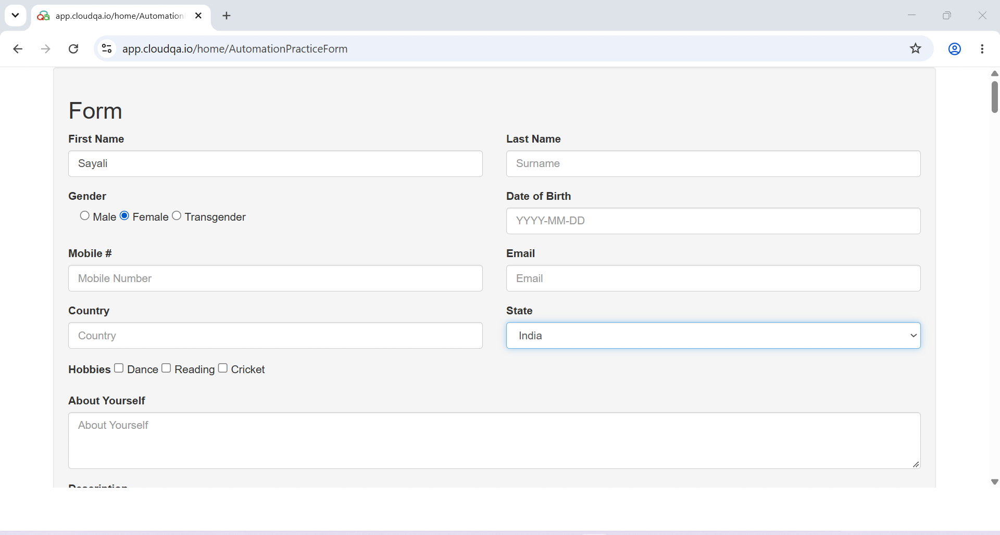
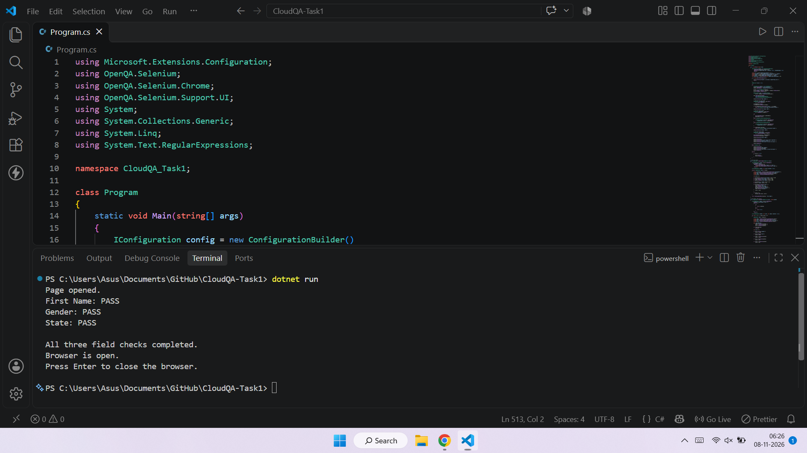

# CloudQA Task 1 – Dynamic Form Automation

## About the Project

This project is part of the CloudQA internship assignment. I built a form automation program using C#, Selenium WebDriver, and .NET.

The purpose of this project is to automate three fields on the CloudQA Automation Practice Form:

- First Name
- Gender
- State

The main focus was to make the automation less dependent on fixed IDs, names, and CSS classes. Instead, the program checks field labels, attributes, and nearby page content to identify the required elements.

**Website:** https://app.cloudqa.io/home/AutomationPracticeForm

## Technologies Used

- C#
- .NET 10
- Selenium WebDriver
- Selenium Support
- Google Chrome

## Project Structure

```text
CloudQA-Task1/
│
├── Program.cs
├── appsettings.json
├── CloudQA-Task1.csproj
├── Approach-and-Limitations.md
└── README.md
```

## What the Program Does

1. Opens the CloudQA practice form in Google Chrome.
2. Finds the First Name textbox and enters the configured value.
3. Finds and selects the requested Gender radio button.
4. Finds the appropriate State dropdown and selects the configured option.
5. Checks whether the required actions were completed successfully.
6. Displays the test results in the terminal.

## How Fields Are Identified

The program uses more than one clue to locate form fields.

- For First Name, it checks the placeholder, accessible label, associated label, and nearby text.
- For Gender, it checks the radio button's label, value, and surrounding group context.
- For State, it checks the available dropdown options and nearby labels or context.

It also checks whether elements are visible and enabled before interacting with them.

## Configuration

The URL and test values are stored in `appsettings.json`.

Example:

```json
{
  "AppSettings": {
    "BaseUrl": "https://app.cloudqa.io/home/AutomationPracticeForm",
    "FirstNameValue": "Sayali",
    "GenderValue": "Female",
    "StateValue": "India",
    "WaitSeconds": 20
  }
}
```

These values can be changed without editing the main C# program.

## How to Run

### Requirements

- .NET SDK 10
- Google Chrome
- Internet connection for package restoration

### Steps

Open the project folder in Visual Studio Code or PowerShell.

Run the following commands:

```bash
dotnet restore
dotnet build
dotnet run
```

Chrome will open automatically and the program will execute the three field checks.

## Test Results

The program was successfully executed on the provided CloudQA practice form.

Terminal output:

```text
Page opened.
First Name: PASS
Gender: PASS
State: PASS

All three field checks completed.
Browser is open.
Press Enter to close the browser.
```
## Screenshots

### 1. CloudQA Form After Automation

The form below shows the First Name, Gender, and State fields after successful automation.



### 2. Code and Execution Output

The screenshot below shows the C# implementation and successful terminal execution.



## Future Improvements

- Improve identification when multiple fields have similar labels or values.
- Add more tests for changes in HTML structure.
- Improve handling of ambiguous matches.
- Add detailed test reports.

## Author

Developed as part of the CloudQA Internship Assignment.